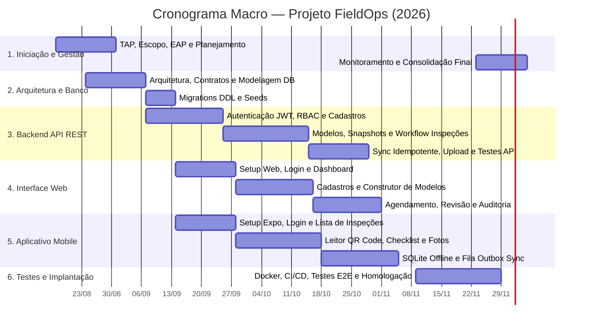

# Cronograma do Projeto FieldOps

## 1. Identificação

| Campo | Informação |
|---|---|
| **Projeto** | FieldOps — Sistema de Gerenciamento e Execução de Inspeções em Campo |
| **Gerente do Projeto** | Murilo Antunes da Silva |
| **Data de Elaboração** | 23/08/2026 |
| **Início Previsto** | 17/08/2026 |
| **Término Previsto** | 04/12/2026 |
| **Versão** | 1.0 |

## 2. Visão Geral (Gráfico de Gantt)

## 3. Lista Detalhada de Atividades (54 itens)

| ID | Fase / Pacote | Atividade | Início | Término | Duração | Responsável | Dependência | Status |
|---|---|---|---|---|---:|---|---|---|
| A01 | 1. Gestão | Elaborar Termo de Abertura do Projeto (TAP) | 17/08 | 19/08 | 3d | Murilo | — | Concluída |
| A02 | 1. Gestão | Mapear partes interessadas e matriz poder/interesse | 20/08 | 21/08 | 2d | Murilo | A01 | Concluída |
| A03 | 1. Gestão | Elaborar Declaração de Escopo e critérios de aceite | 22/08 | 24/08 | 3d | Pedro | A01 | Concluída |
| A04 | 1. Gestão | Construir Estrutura Analítica do Projeto (EAP) e dicionário | 22/08 | 24/08 | 3d | Murilo | A03 | Concluída |
| A05 | 1. Gestão | Definir cronograma detalhado, dependências e marcos | 25/08 | 26/08 | 2d | Murilo | A04 | Planejada |
| A06 | 1. Gestão | Elaborar orçamento e estimativa de custos | 27/08 | 28/08 | 2d | Murilo | A04 | Planejada |
| A07 | 1. Gestão | Definir plano de qualidade e métricas de verificação | 27/08 | 28/08 | 2d | Pedro | A03 | Planejada |
| A08 | 1. Gestão | Elaborar organograma, matriz RACI e plano de comunicação | 29/08 | 31/08 | 3d | Murilo | A02, A05 | Planejada |
| A09 | 1. Gestão | Mapear riscos, severidade e planos de resposta | 01/09 | 02/09 | 2d | Murilo | A05, A06 | Planejada |
| A10 | 2. Arquitetura e DB | Definir arquitetura distribuída (Mobile, Web, API, Storage) | 24/08 | 26/08 | 3d | Pedro | A03 | Planejada |
| A11 | 2. Arquitetura e DB | Especificar contratos iniciais de API (OpenAPI / DTOs) | 27/08 | 31/08 | 5d | Pedro | A10 | Planejada |
| A12 | 2. Arquitetura e DB | Elaborar modelo conceitual e DER do banco de dados | 27/08 | 31/08 | 5d | Juan | A10 | Planejada |
| A13 | 2. Arquitetura e DB | Normalizar modelo lógico e definir índices e constraints | 01/09 | 04/09 | 4d | Juan | A12 | Planejada |
| A14 | 2. Arquitetura e DB | Provisionar container PostgreSQL e Object Storage (MinIO/S3) | 05/09 | 07/09 | 3d | Murilo | A10 | Planejada |
| A15 | 2. Arquitetura e DB | Criar scripts DDL de migrations iniciais | 08/09 | 11/09 | 4d | Juan | A13, A14 | Planejada |
| A16 | 2. Arquitetura e DB | Desenvolver scripts de seed com dados de demonstração | 12/09 | 14/09 | 3d | Juan | A15 | Planejada |
| A17 | 3. Backend API | Estruturar projeto Spring Boot e configurações de ambiente | 07/09 | 09/09 | 3d | Pedro | A14 | Planejada |
| A18 | 3. Backend API | Implementar autenticação JWT e criptografia de senhas | 10/09 | 14/09 | 5d | Pedro | A15, A17 | Planejada |
| A19 | 3. Backend API | Implementar autorização por perfis (RBAC: Admin, Supervisor, Técnico) | 15/09 | 17/09 | 3d | Pedro | A18 | Planejada |
| A20 | 3. Backend API | Desenvolver endpoints CRUD de usuários e clientes | 18/09 | 21/09 | 4d | Pedro | A19 | Planejada |
| A21 | 3. Backend API | Desenvolver endpoints de locais e equipamentos com código QR | 22/09 | 25/09 | 4d | Pedro | A20 | Planejada |
| A22 | 3. Backend API | Implementar módulo de modelos de checklist com versionamento | 26/09 | 01/10 | 6d | Pedro | A21 | Planejada |
| A23 | 3. Backend API | Implementar geração de snapshots imutáveis em JSONB | 02/10 | 06/10 | 5d | Pedro | A22 | Planejada |
| A24 | 3. Backend API | Desenvolver endpoints de agendamento e atribuição de inspeções | 07/10 | 10/10 | 4d | Pedro | A23 | Planejada |
| A25 | 3. Backend API | Implementar máquina de estados e revisão (aprovar/reprovar) | 11/10 | 15/10 | 5d | Pedro | A24 | Planejada |
| A26 | 3. Backend API | Implementar trilha de auditoria (`AuditEvent`) em mudanças críticas | 16/10 | 19/10 | 4d | Pedro | A25 | Planejada |
| A27 | 3. Backend API | Desenvolver endpoint de sincronização em lote idempotente (Outbox) | 20/10 | 26/10 | 7d | Pedro | A25 | Planejada |
| A28 | 3. Backend API | Implementar upload e recuperação de evidências fotográficas | 27/10 | 30/10 | 4d | Pedro | A14, A27 | Planejada |
| A29 | 3. Backend API | Escrever testes unitários/integração e publicar Swagger UI | 31/10 | 04/11 | 5d | Pedro | A28 | Planejada |
| A30 | 4. Frontend Web | Configurar projeto React/Vite, rotas e layout base | 14/09 | 17/09 | 4d | Matheus | A11 | Planejada |
| A31 | 4. Frontend Web | Implementar tela de login, proteção de rotas e contexto de sessão | 18/09 | 22/09 | 5d | Matheus | A18, A30 | Planejada |
| A32 | 4. Frontend Web | Construir Dashboard do Supervisor com indicadores e alertas | 23/09 | 28/09 | 6d | Matheus | A24, A31 | Planejada |
| A33 | 4. Frontend Web | Desenvolver telas CRUD de usuários, clientes e locais | 29/09 | 03/10 | 5d | Matheus | A20, A31 | Planejada |
| A34 | 4. Frontend Web | Desenvolver tela de equipamentos e geração/impressão de QR Code | 04/10 | 08/10 | 5d | Matheus | A21, A33 | Planejada |
| A35 | 4. Frontend Web | Implementar Construtor Visual de Modelos de Inspeção | 09/10 | 16/10 | 8d | Matheus | A22, A31 | Planejada |
| A36 | 4. Frontend Web | Implementar módulo de agendamento e atribuição aos técnicos | 17/10 | 22/10 | 6d | Matheus | A24, A34, A35 | Planejada |
| A37 | 4. Frontend Web | Construir Painel de Revisão de inspeções com galeria de fotos | 23/10 | 29/10 | 7d | Matheus | A25, A28, A36 | Planejada |
| A38 | 4. Frontend Web | Implementar tela de histórico de auditoria e testes de interface | 30/10 | 03/11 | 5d | Matheus | A26, A37 | Planejada |
| A39 | 5. Mobile | Configurar projeto Expo / React Native, navegação e design base | 14/09 | 17/09 | 4d | Julio | A11 | Planejada |
| A40 | 5. Mobile | Implementar login mobile e armazenamento seguro de token/sessão | 18/09 | 22/09 | 5d | Julio | A18, A39 | Planejada |
| A41 | 5. Mobile | Desenvolver tela inicial e listagem de inspeções com filtros | 23/09 | 27/09 | 5d | Gizela | A24, A40 | Planejada |
| A42 | 5. Mobile | Implementar leitor de QR Code para identificação do equipamento | 28/09 | 02/10 | 5d | Julio | A21, A41 | Planejada |
| A43 | 5. Mobile | Desenvolver renderização dinâmica de seções e perguntas do checklist | 03/10 | 09/10 | 7d | Gizela | A23, A41 | Planejada |
| A44 | 5. Mobile | Implementar captura de fotos, compressão e registro de GPS | 10/10 | 15/10 | 6d | Julio | A43 | Planejada |
| A45 | 5. Mobile | Desenvolver registro de observações e não conformidades | 16/10 | 19/10 | 4d | Gizela | A43 | Planejada |
| A46 | 5. Mobile | Modelar e implementar banco local SQLite para modo offline | 20/10 | 26/10 | 7d | Julio | A44, A45 | Planejada |
| A47 | 5. Mobile | Implementar fila Outbox, retry e sincronização bidirecional | 27/10 | 03/11 | 8d | Julio | A27, A46 | Planejada |
| A48 | 5. Mobile | Desenvolver tela de status de sincronização e tratamento de erros | 04/11 | 06/11 | 3d | Gizela | A47 | Planejada |
| A49 | 6. Testes e Infra | Configurar pipeline CI/CD no GitHub Actions (lint, build e testes) | 07/09 | 11/09 | 5d | Murilo | A14 | Planejada |
| A50 | 6. Testes e Infra | Consolidar `docker-compose.yml` unificando DB, API, Web e Storage | 04/11 | 08/11 | 5d | Murilo | A29, A38, A49 | Planejada |
| A51 | 6. Testes e Infra | Executar testes integrados ponta a ponta (Web + API + Mobile) | 09/11 | 15/11 | 7d | Equipe | A48, A50 | Planejada |
| A52 | 6. Testes e Infra | Validar cenário offline-first em campo (modo avião e reconexão) | 16/11 | 20/11 | 5d | Julio e Gizela | A51 | Planejada |
| A53 | 6. Testes e Infra | Gerar build APK de distribuição, corrigir defeitos e preparar deploy | 21/11 | 27/11 | 7d | Murilo e Pedro | A52 | Planejada |
| A54 | 1. Gestão | Consolidar relatório final, lições aprendidas e apresentação | 28/11 | 04/12 | 7d | Equipe | A53 | Planejada |

## 4. Marcos do Projeto (Milestones)

| ID | Marco | Data Prevista | Critério de Verificação |
|---|---|---|---|
| M1 | Kick-off e Linha de Base do Planejamento | 31/08/2026 | TAP, Escopo, EAP, Cronograma e Planos documentados |
| M2 | Fundação de Dados, Contratos e CI | 14/09/2026 | PostgreSQL rodando em Docker, migrations e OpenAPI publicados |
| M3 | Núcleo Backend e Telas Base Operacionais | 15/10/2026 | Autenticação JWT, cadastros, modelos e workflow ativos |
| M4 | Operação Mobile Offline e Sincronização Prontas | 06/11/2026 | Checklist salvo em SQLite e sincronizado via fila Outbox |
| M5 | Homologação Ponta a Ponta Concluída | 27/11/2026 | Fluxo completo aprovado em ambiente integrado e APK gerado |
| M6 | Encerramento e Apresentação Final | 04/12/2026 | Documentação final entregue e sistema apresentado |

## 5. Distribuição por Responsável

| Responsável | Foco Principal | Atividades Alocadas |
|---|---|---|
| Murilo Antunes da Silva | Gerente de Projeto / DevOps / CI-CD / Custos / Riscos | A01, A02, A04, A05, A06, A08, A09, A14, A49, A50, A51, A53, A54 |
| Julio Coronetti Regino | Mobile (Offline / Sync / QR Code) | A39, A40, A42, A44, A46, A47, A51, A52, A54 |
| Gizela Alves | Mobile (Telas / Checklist / Validação) | A41, A43, A45, A48, A51, A52, A54 |
| Pedro Vieira | Backend / API REST / Regras de Negócio | A03, A07, A10, A11, A17–A29, A51, A53, A54 |
| Matheus | Frontend Web (Dashboard / Construtor / Revisão) | A30–A38, A51, A54 |
| Juan | Banco de Dados (Modelagem / Migrations / Seeds) | A12, A13, A15, A16, A51, A54 |
