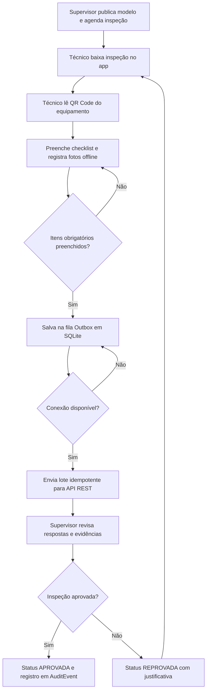
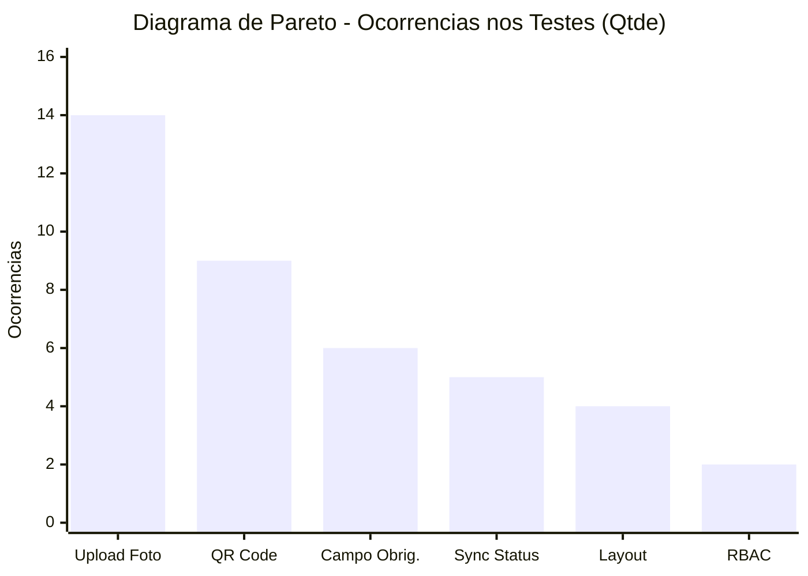
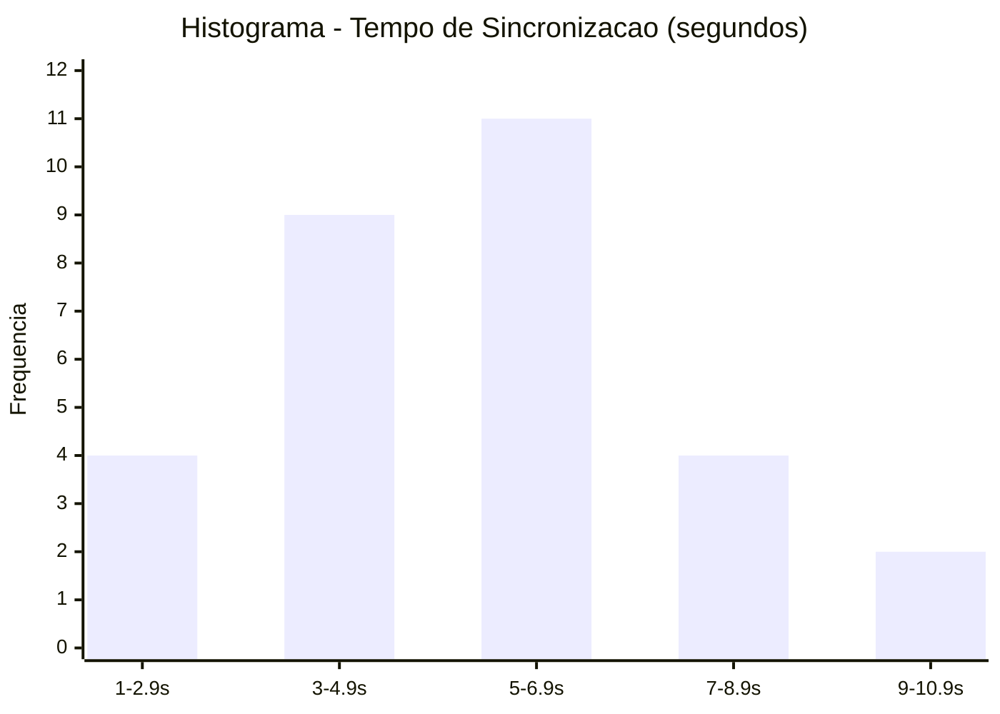
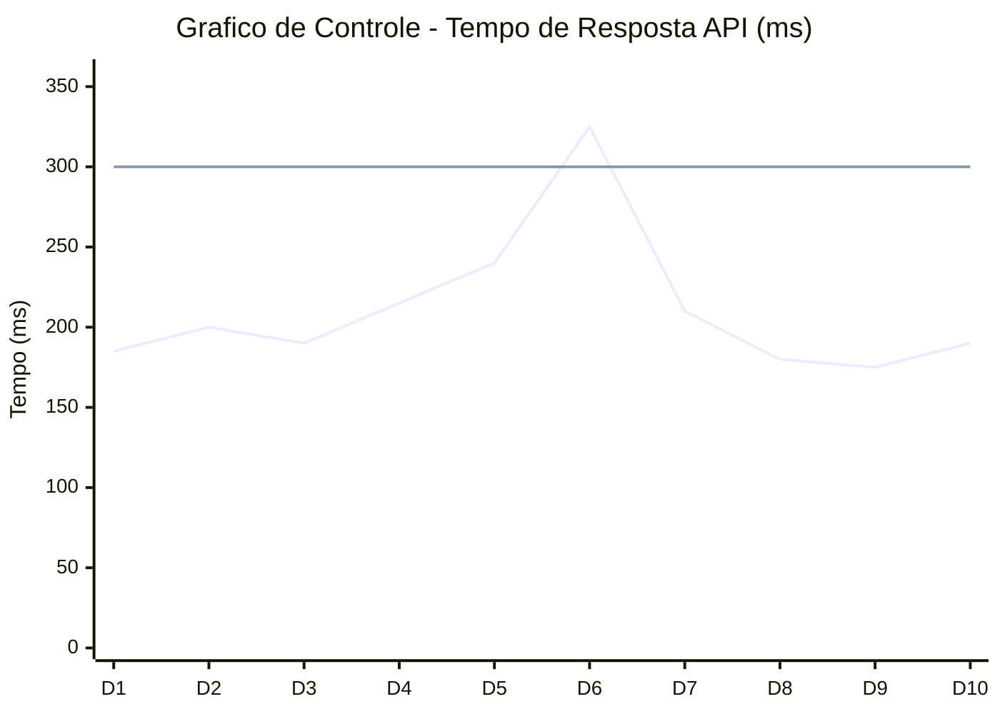
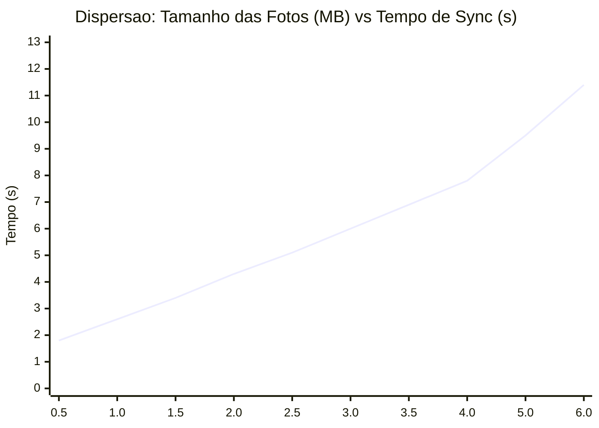

# Análise de Qualidade — Projeto FieldOps (Sete Ferramentas Básicas)

## 1. Identificação

| Campo | Informação |
|---|---|
| **Projeto** | FieldOps — Sistema de Gerenciamento e Execução de Inspeções em Campo |
| **Objetivo** | Avaliar falhas potenciais, fluxo operacional e controle de qualidade com as 7 Ferramentas Básicas |
| **Data** | 30/08/2026 |

---

## 2. Ferramenta 1 — Diagrama de Causa e Efeito (Ishikawa)

**Problema analisado:** Falha ou perda parcial na sincronização de inspeções realizadas em campo (modo offline).

```text
  MÉTODO                         MÁQUINA / DISPOSITIVO
  ├── Falta de fila Outbox       ├── Memória RAM reduzida
  ├── Reenvio sem idempotência   ├── Bateria descarregada em campo
  └── Sem validação de campos    └── Câmera gerando fotos > 10 MB
             \                           /
              \                         /
               +-----------------------+---> FALHA NA SINCRONIZAÇÃO
              /                         \    DE INSPEÇÕES EM CAMPO
             /                           \
  REDE / INFRA                   PESSOAS / OPERAÇÃO
  ├── Área sem sinal 4G/Wi-Fi    ├── Fechamento forçado do app
  ├── Timeout curto na API       ├── Preenchimento incompleto
  └── Indisponibilidade S3/DB    └── Fotos fora de foco / sem QR
```

**Conclusão:** As causas críticas concentram-se na combinação entre instabilidade de rede em campo e ausência de persistência transacional/idempotência. A mitigação direta é a gravação imediata em SQLite local, compressão de imagens antes da fila Outbox e chaves UUID idempotentes na API.

---

## 3. Ferramenta 2 — Fluxograma

Fluxo ponta a ponta da inspeção e tratamento de não conformidade entre Mobile, API e Web:



**Conclusão:** O ponto de decisão `Itens obrigatórios preenchidos?` impede o envio de vistorias incompletas, enquanto o loop de reprovação garante rastreabilidade antes da aprovação final.

---

## 4. Ferramenta 3 — Folha de Verificação

Coleta simulada de defeitos e ocorrências registrados durante os testes piloto de 40 inspeções em ambiente de homologação (Sprints 4 a 6):

| Tipo de Ocorrência | Registro de Ocorrências | Total |
|---|---|---:|
| Erro de timeout no upload de fotos pesadas | `||||| ||||| ||||` | 14 |
| Falha na leitura de QR Code com baixa iluminação | `||||| ||||` | 9 |
| Rejeição por campo obrigatório não preenchido | `||||| |` | 6 |
| Divergência de status após reconexão simultânea | `|||||` | 5 |
| Inconsistência de layout em tela pequena | `||||` | 4 |
| Erro de permissão RBAC em rota administrativa | `||` | 2 |
| **Total de ocorrências analisadas** | | **40** |

**Conclusão:** As ocorrências ligadas a envio de imagens e leitura de QR Code concentram mais da metade dos registros em campo.

---

## 5. Ferramenta 4 — Diagrama de Pareto

Priorização dos defeitos levantados na Folha de Verificação:

| Categoria de Defeito | Frequência | % Individual | % Acumulado |
|---|---:|---:|---:|
| Timeout no upload de fotos pesadas | 14 | 35,0% | 35,0% |
| Falha de leitura de QR Code (baixa luz) | 9 | 22,5% | 57,5% |
| Campo obrigatório não preenchido | 6 | 15,0% | 72,5% |
| Divergência de status na reconexão | 5 | 12,5% | 85,0% |
| Inconsistência de layout mobile | 4 | 10,0% | 95,0% |
| Erro de permissão RBAC | 2 | 5,0% | 100,0% |



**Conclusão (regra 80/20):** Tratar os três primeiros problemas (compressão de fotos, suporte a lanterna/contraste no leitor QR e bloqueio preventivo de campos obrigatórios) resolve **72,5%** das falhas, chegando a **85,0%** ao incluir a idempotência do sync.

---

## 6. Ferramenta 5 — Histograma

Distribuição do **tempo de sincronização em lote (em segundos)** medido em 30 execuções de teste (inspeções com 3 a 5 fotos comprimidas via 4G):

| Faixa de Tempo (s) | Frequência (nº de syncs) |
|---|---:|
| 1,0 – 2,9 s | 4 |
| 3,0 – 4,9 s | 9 |
| 5,0 – 6,9 s | 11 |
| 7,0 – 8,9 s | 4 |
| 9,0 – 10,9 s | 2 |



**Conclusão:** A distribuição concentra-se entre **3,0 s e 6,9 s** (20 de 30 amostras, ou 66,7%), indicando desempenho estável para pacotes compactados, com apenas 2 casos acima de 9 s em sinal 4G degradado.

---

## 7. Ferramenta 6 — Gráfico de Controle

Acompanhamento do **tempo médio de resposta da API REST (ms)** nos endpoints principais ao longo de 10 dias de testes contínuos, com **Limite Superior de Controle (LSC) = 300 ms**, **Linha Média (LM) = 195 ms** e **Limite Inferior de Controle (LIC) = 90 ms**:

| Dia | Tempo Médio (ms) | LSC (ms) | LM (ms) | LIC (ms) | Situação |
|---|---:|---:|---:|---:|---|
| D1 | 185 | 300 | 195 | 90 | Sob controle |
| D2 | 200 | 300 | 195 | 90 | Sob controle |
| D3 | 190 | 300 | 195 | 90 | Sob controle |
| D4 | 215 | 300 | 195 | 90 | Sob controle |
| D5 | 240 | 300 | 195 | 90 | Sob controle |
| D6 | 325 | 300 | 195 | 90 | Fora de controle (LSC) |
| D7 | 210 | 300 | 195 | 90 | Sob controle (após índice) |
| D8 | 180 | 300 | 195 | 90 | Sob controle |
| D9 | 175 | 300 | 195 | 90 | Sob controle |
| D10 | 190 | 300 | 195 | 90 | Sob controle |



**Conclusão:** No dia **D6** o processo ultrapassou o LSC (325 ms > 300 ms) devido a consulta sem índice na tabela de histórico. Após a criação de índice no PostgreSQL, o tempo retornou à faixa esperada (175–210 ms).

---

## 8. Ferramenta 7 — Diagrama de Dispersão

Análise da correlação entre o **tamanho total das evidências fotográficas (MB)** por inspeção e o **tempo de sincronização (segundos)** em rede 4G:

| Inspeção | Tamanho Total (MB) | Tempo de Sync (s) |
|---|---:|---:|
| I-01 | 0,5 | 1,8 |
| I-02 | 1,0 | 2,6 |
| I-03 | 1,5 | 3,4 |
| I-04 | 2,0 | 4,3 |
| I-05 | 2,5 | 5,1 |
| I-06 | 3,0 | 6,0 |
| I-07 | 3,5 | 6,9 |
| I-08 | 4,0 | 7,8 |
| I-09 | 5,0 | 9,5 |
| I-10 | 6,0 | 11,4 |



**Conclusão:** Existe **correlação linear positiva forte** entre o volume de imagens e o tempo de sincronização (aproximadamente +1,9 s por MB adicional). Isso valida a decisão técnica de comprimir cada fotografia no aplicativo para no máximo ~300 KB antes de colocá-la na fila Outbox.

---

## 9. Síntese Geral das Ações de Qualidade

1. **Compressão de imagens no mobile:** reduzir payload médio por inspeção para < 1,5 MB, mantendo o tempo de sync abaixo de 4 s.
2. **Idempotência na fila Outbox:** uso obrigatório de UUID por operação para evitar duplicações em reconexões.
3. **Indexação no PostgreSQL e monitoramento:** manter consultas abaixo de 300 ms com alertas automatizados.
4. **Validação em campo com checklist de aceitação:** exigir todos os campos obrigatórios antes de encerrar a vistoria offline.
