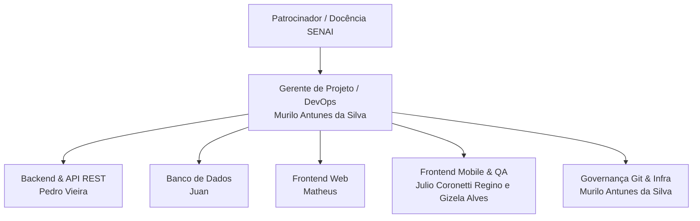

# Recursos Humanos — Organograma e Matriz RACI do Projeto FieldOps

## 1. Identificação

| Campo | Informação |
|---|---|
| **Projeto** | FieldOps — Sistema de Gerenciamento e Execução de Inspeções em Campo |
| **Gerente do Projeto** | Murilo Antunes da Silva |
| **Docente Orientador** | Prof. Me. Deivison S. Takatu |
| **Data** | 02/09/2026 |

---

## 2. Organograma do Projeto

### Papéis e Responsabilidades

| Integrante | Papel Principal | Foco Técnico |
|---|---|---|
| Murilo Antunes da Silva | Gerente de Projeto / DevOps | Planejamento, gestão de riscos e custos, governança Git, CI/CD, Docker e deploy |
| Julio Coronetti Regino | Desenvolvedor Mobile | Arquitetura mobile, leitor QR Code, persistência SQLite e fila Outbox |
| Gizela Alves | Desenvolvedora Mobile e QA | Telas de checklist, captura de evidências, usabilidade e testes em campo |
| Pedro Vieira | Líder de Backend | API REST Spring Boot, JWT/RBAC, snapshots JSONB e sync idempotente |
| Matheus | Líder de Frontend Web | Dashboard administrativo, construtor de modelos, agendamento e revisão |
| Juan | Administrador de Banco de Dados | Modelagem relacional PostgreSQL, migrations DDL e seeds de teste |

---

## 3. Matriz RACI

Legenda:
- **R (Responsible / Responsável):** executa a atividade.
- **A (Accountable / Aprovador):** responde pela entrega final e aprova o resultado.
- **C (Consulted / Consultado):** fornece insumos técnicos ou valida decisões antes da conclusão.
- **I (Informed / Informado):** recebe atualização sobre andamento e resultado.

| Atividade / Entrega | Julio | Gizela | Pedro | Matheus | Juan | Murilo |
|---|:---:|:---:|:---:|:---:|:---:|:---:|
| 1. Termo de Abertura, Escopo e EAP | C | I | C | I | C | A / R |
| 2. Cronograma, RACI e Comunicação | C | C | C | C | C | A / R |
| 3. Orçamento, Riscos e Governança | C | I | C | I | I | A / R |
| 4. Arquitetura e Contratos OpenAPI | C | I | A / R | C | C | C |
| 5. Modelagem Relacional e DER (PostgreSQL) | I | I | C | I | A / R | I |
| 6. Scripts DDL de Migrations e Seeds | I | I | C | I | R | A |
| 7. Autenticação JWT e Controle RBAC (API) | C | I | A / R | C | C | I |
| 8. Modelos Versionados e Snapshots JSONB | C | I | A / R | C | C | I |
| 9. Endpoint de Sincronização em Lote | C | C | A / R | I | C | I |
| 10. Dashboard e Cadastros Web | I | I | C | A / R | I | I |
| 11. Construtor de Modelos e Revisão Web | I | I | C | A / R | I | I |
| 12. Login, Listagem e Leitor QR Code Mobile | A / R | R | C | I | I | I |
| 13. Checklist Dinâmico, Fotos e Não Conformidades | C | A / R | C | I | I | I |
| 14. Banco Local SQLite e Fila Outbox | A / R | C | C | I | I | I |
| 15. Docker Compose e Pipeline CI/CD | I | I | C | C | C | A / R |
| 16. Testes Integrados Ponta a Ponta (E2E) | R | R | R | R | R | A |
| 17. Consolidação Final e Apresentação | R | R | R | R | R | A / R |
