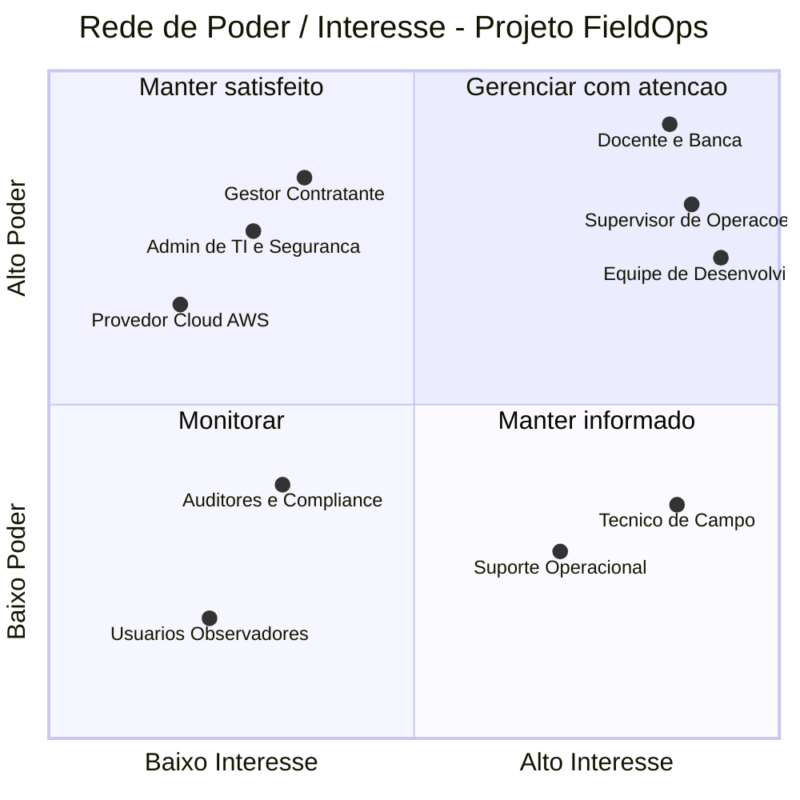

# Partes Interessadas — Matriz de Rede de Poder/Interesse do Projeto FieldOps

## 1. Identificação

| Campo | Informação |
|---|---|
| **Projeto** | FieldOps — Sistema de Gerenciamento e Execução de Inspeções em Campo |
| **Responsável** | Julio Coronetti Regino |
| **Data** | 27/09/2026 |

---

## 2. Rede de Poder / Interesse



```text
       PODER (Influência / Autoridade)
       ^
  ALTO |  [ MANTER SATISFEITO ]            |  [ GERENCIAR COM ATENÇÃO ]
       |  - Gestor do Cliente Contratante  |  - Docente Orientador e Banca
       |  - Administrador de TI/Segurança  |  - Supervisor de Operações
       |  - Infraestrutura Cloud (AWS/EAS) |  - Equipe de Desenvolvimento
-------+-----------------------------------+----------------------------------->
       |  [ MONITORAR ]                    |  [ MANTER INFORMADO ]
 BAIXO |  - Auditores e Compliance         |  - Técnico de Campo
       |  - Usuários Observadores          |  - Equipe de Suporte Operacional
       +-----------------------------------+----------------------------------->
                     BAIXO                               ALTO
                                   INTERESSE (Impacto / Expectativa)
```

---

## 3. Classificação e Estratégia de Engajamento

| ID | Parte Interessada | Poder | Interesse | Quadrante | Expectativa Principal | Estratégia de Engajamento |
|---|---|---:|---:|---|---|---|
| SH-01 | Docente Orientador e Banca Avaliadora | Alto | Alto | Gerenciar com atenção | Cumprimento dos requisitos, qualidade técnica e entrega no prazo | Apresentações por marco, entregas semanais no GitHub e demonstração final ponta a ponta |
| SH-02 | Supervisor de Operações | Alto | Alto | Gerenciar com atenção | Dashboard claro, construtor de modelos prático e revisão confiável | Validação periódica de telas web e fluxo de aprovação/reprovação |
| SH-03 | Equipe de Desenvolvimento (6 integrantes) | Alto | Alto | Gerenciar com atenção | Contratos bem definidos, divisão equilibrada e integração contínua | Dailies curtas, Pull Requests revisados e quadro Kanban atualizado |
| SH-04 | Gestor do Cliente Contratante | Alto | Baixo/Médio | Manter satisfeito | Visibilidade gerencial, redução de falhas e confiabilidade dos laudos | Relatórios consolidados nos marcos principais sem sobrecarga operacional |
| SH-05 | Administrador de TI e Segurança | Alto | Baixo/Médio | Manter satisfeito | Autenticação JWT, RBAC estrito e proteção de dados/credenciais | Documentação de segurança, controle de acessos e boas práticas de arquitetura |
| SH-06 | Provedores Cloud / Build (AWS / Expo EAS) | Alto | Baixo | Manter satisfeito | Adequação a cotas, limites de recursos e estabilidade dos containers | Arquitetura enxuta em Docker Compose e monitoramento de uso |
| SH-07 | Técnico de Campo | Baixo | Alto | Manter informado | App simples, leitura rápida de QR Code e zero perda de dados offline | Testes piloto de usabilidade, guias visuais e canal direto de feedback |
| SH-08 | Equipe de Suporte Operacional | Baixo | Alto | Manter informado | Clareza nos erros de sincronização e histórico para atendimento | Manuais básicos de operação e mensagens claras de erro no app e na API |
| SH-09 | Auditores de Qualidade e Compliance | Baixo/Médio | Baixo | Monitorar | Imutabilidade dos snapshots e registro de alterações (`AuditEvent`) | Manutenção passiva de trilhas de auditoria e logs estruturados |
| SH-10 | Usuários Observadores | Baixo | Baixo | Monitorar | Consulta simples de relatórios e histórico quando liberado | Acesso somente leitura conforme evolução do produto |
